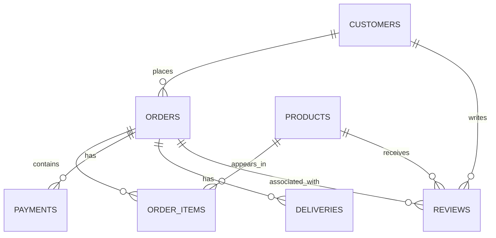

# UrbanMart SQL Project

A beginner-friendly e-commerce database project built with **MySQL 8+** to practise SQL fundamentals, relational modelling, analytics, window functions, and data-quality checks.

> **Dataset note:** UrbanMart is fictional. The customer names, order history, products, and transactions are synthetic sample data created for learning—not real customer or business records.

## Business scenario

UrbanMart is a fictional Indian e-commerce retailer. The database stores customers, products, orders, order items, payments, deliveries, and product reviews. The SQL exercises answer common business questions and identify data-quality issues.

## Project goals

- Design a relational database with primary and foreign keys.
- Practise `SELECT`, `WHERE`, `ORDER BY`, `LIMIT`, and `CASE`.
- Analyse data with aggregate functions, `GROUP BY`, and `HAVING`.
- Join multiple related tables.
- Use subqueries and common table expressions (CTEs).
- Apply `RANK()`, `DENSE_RANK()`, `ROW_NUMBER()`, and `LAG()`.
- Calculate daily and cumulative revenue.
- Check missing records, mismatched amounts, invalid dates, duplicate-like emails, and stock issues.

## Technology

- MySQL 8.0 or later
- MySQL Workbench (recommended)
- Git and GitHub

## Repository structure

```text
UrbanMart-SQL-Project/
├── README.md
├── .gitignore
├── database/
│   ├── 01_create_tables.sql
│   └── 02_insert_sample_data.sql
├── queries/
│   ├── 01_basic_queries.sql
│   ├── 02_aggregations.sql
│   ├── 03_joins.sql
│   ├── 04_subqueries_and_ctes.sql
│   ├── 05_window_functions.sql
│   └── 06_data_quality.sql
├── documentation/
│   └── DATA_DICTIONARY.md
└── screenshots/
    
```

## Database schema

Seven tables are included:

| Table | Purpose | Primary key |
|---|---|---|
| `customers` | Customer profile and signup information | `customer_id` |
| `products` | Product catalogue, pricing, stock, and supplier | `product_id` |
| `orders` | Order header, customer, date, status, and total | `order_id` |
| `order_items` | Products and quantities included in each order | `order_item_id` |
| `payments` | Payment method, amount, and payment status | `payment_id` |
| `deliveries` | Courier and shipping/delivery dates | `delivery_id` |
| `reviews` | Customer product ratings and review text | `review_id` |

### Relationships



The foreign keys enforce relationships between existing records. `order_items` is the bridge between orders and products, allowing an order to contain multiple products and a product to appear in multiple orders.

## How to run the project

1. Install and open MySQL Workbench, then connect to your local MySQL server.
2. Open and execute `database/01_create_tables.sql`. It creates the `urbanmart` database and its tables.
3. Open and execute `database/02_insert_sample_data.sql` to load the sample records.
4. Verify the tables:

   ```sql
   USE urbanmart;
   SHOW TABLES;
   SELECT COUNT(*) FROM customers;
   SELECT COUNT(*) FROM products;
   SELECT COUNT(*) FROM orders;
   ```

5. Run the query files in `queries/` in numerical order. Each file contains exercises for one SQL topic.

**Rerunning from scratch:** The setup script does not drop an existing database. If you want a fresh reset, back up anything important and drop the `urbanmart` database manually before running the setup file again.

## SQL topics covered

| File | Topics |
|---|---|
| `01_basic_queries.sql` | Filtering, sorting, `LIMIT`, basic selection |
| `02_aggregations.sql` | `COUNT`, `SUM`, `AVG`, `MAX`, `GROUP BY`, `HAVING` |
| `03_joins.sql` | `INNER JOIN`, `LEFT JOIN`, multi-table joins |
| `04_subqueries_and_ctes.sql` | Scalar subqueries, `EXISTS`, CTEs, customer/monthly metrics |
| `05_window_functions.sql` | Ranking, category-wise ranking, running revenue, `LAG`, latest-order comparisons |
| `06_data_quality.sql` | Duplicate-like emails, missing payments, payment mismatches, date validation, stock checks, missing order items |

## Revenue definition used in analytical examples

For examples labelled as revenue or spending, the query files generally exclude orders with status `Cancelled` or `Returned`. This is a simple learning-project rule. A production system should define revenue more carefully, including payment success, refunds, partial returns, discounts, and accounting rules.

The data-quality queries are diagnostic checks. A returned row should be investigated against business rules rather than automatically deleted or changed.

## Important design notes

- `customers.email` has a `UNIQUE` constraint. Therefore, exact duplicate non-NULL email values should be blocked in this database. The duplicate-email query also normalizes case and surrounding whitespace, which can reveal duplicate-like values if data is imported into a staging table without that constraint.
- The sample `payments` table has a payment row for each sample order, so the missing-payment check is expected to return no rows on the untouched seed data.
- The sample data does not deliberately include negative/zero stock or invalid delivery dates. Those checks may also return no rows until you test them with controlled test records.
- Some products have order-item prices different from catalogue prices. This can represent a discount or order-time price; `order_items.unit_price` is the historical price used for that order.

## Example business questions

- Which customers have the highest total spending?
- Which products are the most expensive within each category?
- What is the second-highest distinct price in each category?
- How does cumulative revenue grow by order date?
- Did a customer's latest order amount increase compared with their previous order?
- Are any orders missing payment records or order items?
- Do payment amounts differ from recorded order totals?
- Are any delivery dates inconsistent with order dates?

## Suggested next improvements

- Add more synthetic records across several months.
- Add constraints for valid ratings, positive quantities, and non-negative prices/stock, once you understand how constraints affect data-quality testing.
- Build an ETL pipeline that loads raw CSV files into staging tables, validates records, and writes clean data to curated tables.
- Connect the data to Python/Pandas or Power BI for reporting.
- Add query result screenshots to `screenshots/`.

## Author

** Aditya Puri **
